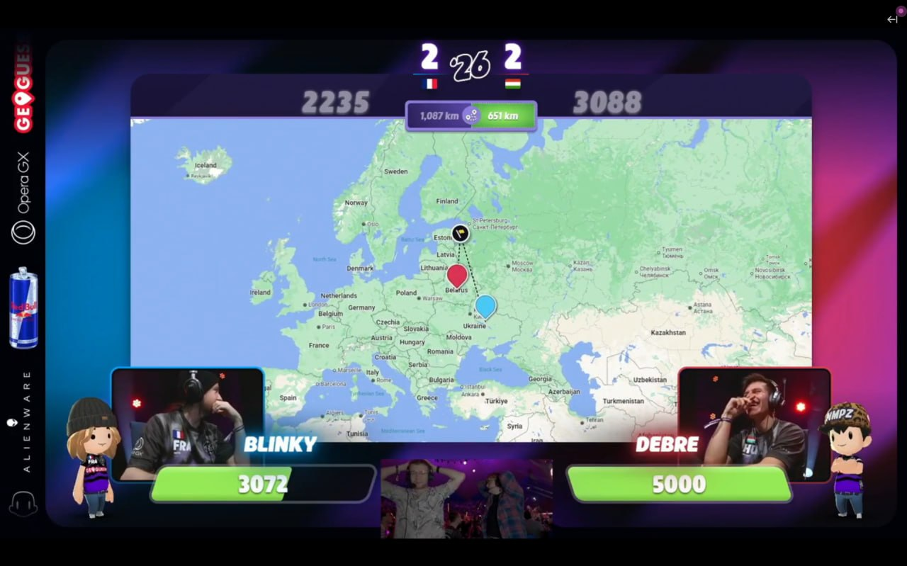

## Беларуси нет на Google street view, но она помогла выиграть венгру чемпионат по Geoguessr

:compass: _Geoguessr_ – компьютерная игра в формате дуэлей, в которой игроку нужно как можно более точно указать местоположение на карте случайной локации из _Google Street View_. Сейчас проходит множество чемпионатов по _Geoguessr_, в том числе чемпионат мира. Для подготовки к соревнованиям игроки изучают и сам _Google Street View_. Такое знание помогает понять, какие страны в теории могут выпасть в игре, а какие нет. Например, Беларусь может выпасть в реальном матче крайне редко, так как _Google_ не делал там покрытия улиц.\
\
Несмотря на это Беларусь может иногда помочь выиграть раунд. Победителем в раунде считается тот игрок, который указал на карте точку ближе к загаданной локации, чем его оппонент. Соответственно, Беларусь благодаря своему расположению между Украиной и европейской частью России иногда используется как защита, если игрок не может определить, Украина перед ним или Россия.\
\
Так во время [финального матча чемпионата мира-2026](https://liquipedia.net/geoguessr/GeoGuessr_World_Championship/2026/Finals) оба участника сомневались, где расположена локация: в Украине или в России. Француз _Blinky_ решил положиться на случайность и неверно выбрал Украину, в то время как венгр _Debre_ осознанно поставил свою точку в Беларуси, чтобы в любом случае оказаться недалеко от локации. Выпавшее игрокам место оказалось в России, поэтому белорусская точка _Debre_ выиграла этот раунд, а сам он вскоре стал чемпионом мира.\
\

