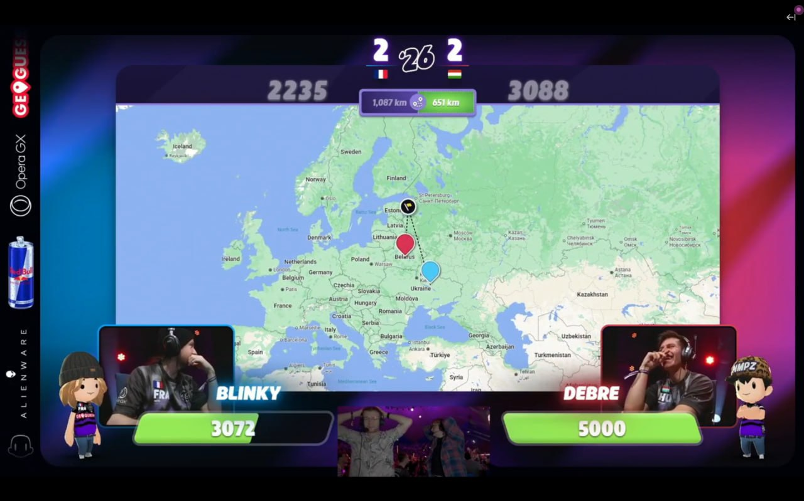

## Беларусь помогла венгру выиграть чемпионат по Geoguessr

:compass: **Geoguessr** – компьютерная игра в формате дуэлей. В ней игроку нужно указать местоположение на карте случайного места из _Google Street View_. По этой игре проходят чемпионаты мира. Для подготовки к соревнованиям игроки изучают сам _Google Street View_. Победителем в раунде становится тот, кто указал на карте точку ближе к загаданной локации, чем его оппонент.\
\
:belarus: **Беларусь** не может попасться в реальном матче, так как _Google_ не делал там покрытия улиц. Однако Беларусь может помочь выиграть раунд, потому что она расположена между Украиной и европейской частью России. Тогда точка в Беларуси может использоваться как защита, если игрок не может определить, Украина перед ним или Россия.\
\
:trophy: В **[финале чемпионата мира-2026](https://liquipedia.net/geoguessr/GeoGuessr_World_Championship/2026/Finals)** сошлись француз _Blinky_ и венгр _Debre_. Оба сомневались, где расположена локация. Они выбирали между Украиной и Россией. _Blinky_ неверно выбрал Украину. _Debre_ поставил точку в Беларуси, чтобы все равно оказаться недалеко от загаданного места. Локация оказалась в России, поэтому белорусская точка _Debre_ выиграла этот раунд. Он вскоре выиграл эту дуэль и стал чемпионом мира.\
\
\
_Скриншот из прямой трансляции: Debre смеется над своей точкой в Беларуси_
